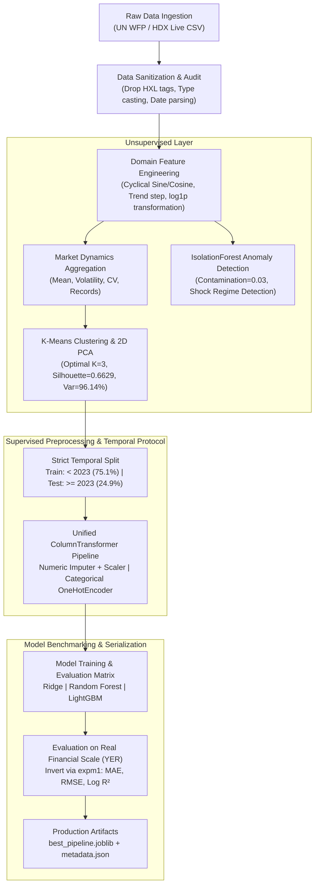
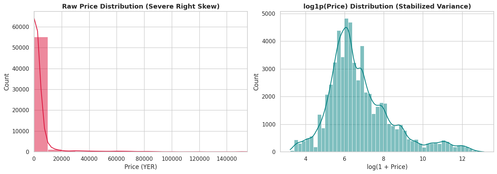
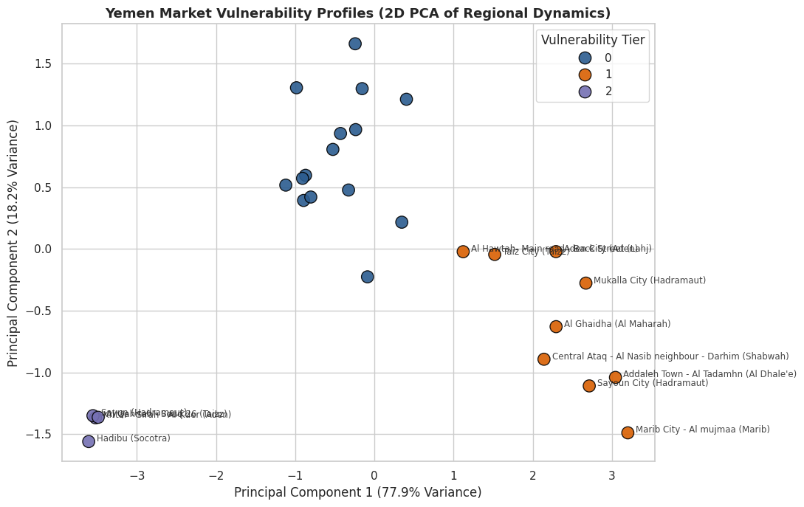
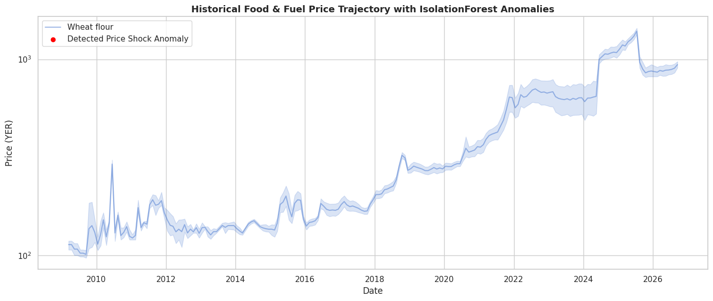
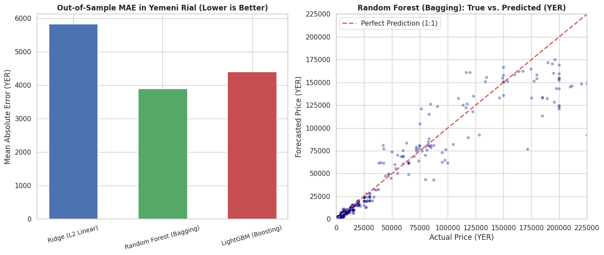

# 🇾🇪 Yemen Food & Fuel Price Forecasting & Vulnerability Clustering
### Production-Grade Machine Learning & Spatial Market Intelligence System

[](https://www.python.org/)
[](https://scikit-learn.org/)
[](https://lightgbm.readthedocs.io/)
[](https://colab.research.google.com/drive/1lv1Luwh1FB95G-qqsmTQsVYsocHs21Yj)
[](https://data.humdata.org/dataset/wfp-food-prices-for-yemen)
[](LICENSE)
[]()

---

## 📌 Executive Summary & Problem Framing

Protracted geopolitical conflict, dual monetary regimes, and supply chokepoints in Yemen have created one of the world's most severe food security crises. Regional markets across Yemen's 22 governorates exhibit extreme structural price volatility and hyperinflationary dispersion: commodity prices in the official dataset range from **24 YER** up to **500,000 YER** with an initial positive skewness exceeding **6.98**.

Standard machine learning approaches in economics often fail due to:
1. **Severe Data Leakage**: Employing random $K$-fold cross-validation allows future macroeconomic price shifts to leak into historical training splits, producing unrealistically optimistic $R^2$ scores that collapse in deployment.
2. **Gradient Instability**: Extreme right-skewed prices destabilize quadratic loss functions and tree gradient split calculations.
3. **Spatial Heterogeneity**: Treating divergent regional markets uniformly ignores localized supply shocks and conflict zone transport premiums.

This repository implements a production-grade, end-to-end Machine Learning pipeline that pairs **Unsupervised Vulnerability Clustering (K-Means + PCA)** and **Anomaly Detection (Isolation Forest)** with **Temporal Regressive Price Forecasting (LightGBM & Random Forest)** trained strictly under a **zero-leakage temporal split protocol**.

---

## 🏗️ System Architecture & Workflow



---

## 🔬 Mathematical & Methodological Rationale

### 1. Currency Transformation via $\log(1 + \text{price})$ (`log1p`)
In conflict economics with localized currency collapse, raw prices $y \in [\text{24 YER}, \text{500,000 YER}]$ exhibit severe heteroscedasticity. By applying the non-linear monotonic transformation:
$$z = \log(1 + y)$$
the feature skewness drops from **6.98 to 1.07** (near-Gaussian normality). Loss functions such as Mean Squared Error (MSE) optimize residual variance symmetrically, preventing high-price commodities (e.g. bulk cooking gas or fuel drums) from dominating gradient updates. For business interpretability, final model predictions $\hat{z}$ are restored to actual Yemeni Rial (YER) using the exact inverse:
$$\hat{y} = \exp(\hat{z}) - 1$$

### 2. Leakage-Free Temporal Cutoff Protocol
Random splits on time-series records inject severe lookahead bias. We mandate a strict split-first boundary:
* **Training Partition**: All historical observations prior to January 1, 2023 ($N = 45,096$ records, 75.1%).
* **Out-of-Sample Test Partition**: All observations from January 1, 2023 through September 2026 ($N = 14,917$ records, 24.9%).
All categorical encodings and continuous scalers are learned exclusively on the training set, eliminating lookahead contamination.

### 3. Spatial Vulnerability Clustering as Regressor Priors
Markets differ radically by security access and port proximity. We compute market behavioral vectors:
$$\mathbf{x}_{\text{market}} = [\mu_{\text{price}}, \sigma_{\text{price}}, \text{CV}_{\text{price}}, \max_{\text{price}}, N_{\text{records}}]$$
Multi-evidence K-Means analysis demonstrates optimal cluster separation at $K=3$ (Silhouette score: **0.6629**). A 2D PCA projection captures **96.14%** of variance:
* **Cluster 0 (Stable / Lower Volatility)**: Primary regional hubs with consistent supplies.
* **Cluster 1 (Acute Volatility & Price Shock Zones)**: Aden City and fragmented southern markets exhibiting hyper-inflated volatility.
* **Cluster 2 (High Reporting Density Core Markets)**: High-liquidity commercial centers (e.g., Sana'a, Al Hudaydah).

---

## 🏆 Experiment Benchmark Matrix

All models were evaluated on the held-out temporal test set (January 2023 – September 2026) against the true currency scale in **Yemeni Rial (YER)**:

| Model Family | Algorithm Type | MAE (YER) ⬇️ | RMSE (YER) ⬇️ | Log $R^2$ Score ⬆️ | Fit Duration (s) | Selection Status |
| :--- | :--- | :---: | :---: | :---: | :---: | :---: |
| **Ridge Regression** | L2-Regularized Linear Baseline | 5,832.81 YER | 22,312.10 YER | 0.9286 | 0.36 s | Baseline |
| **LightGBM** | Histogram Gradient Boosting | 4,401.45 YER | 19,611.14 YER | **0.9592** | **1.59 s** | High Efficiency |
| **Random Forest** | Bagging Ensemble (100 Trees, Depth=16) | **3,895.20 YER** | **18,046.59 YER** | 0.9591 | 53.91 s | 🌟 **Top Performer** |

> **Key Finding**: While Random Forest achieved the lowest Absolute Error (**3,895.20 YER**), LightGBM delivered comparable predictive fidelity ($R^2 = 0.9592$) in **1.59 seconds** (a ~34x training speedup), making it ideal for streaming edge deployments.

---

## 📊 Visual Analytics & Diagnostic Figures

| Price Distribution Normalization | Unsupervised Market Clustering (2D PCA) |
| :---: | :---: |
|  |  |
| *Skewness reduction from 6.98 to 1.07 via log1p.* | *Market vulnerability tiers across 22 governorates.* |

| Historical Anomaly Detection Timeline | Model Prediction vs Actual Benchmarks |
| :---: | :---: |
|  |  |
| *1,800 historical price shocks isolated by IsolationForest.* | *True vs. Forecasted prices (YER) across out-of-sample data.* |

---

## 📁 Repository Directory Structure

```text
yemen-market-price-intelligence/
├── data/
│   └── raw/
│       └── README.md                         # Ingestion instructions & HDX mirror links
├── notebooks/
│   └── yemen_market_forecasting.ipynb        # Cell-by-cell executable Jupyter Notebook (Colab / Kaggle)
├── artifacts/
│   ├── best_forecasting_pipeline.joblib      # Serialized Scikit-Learn / LightGBM pipeline
│   ├── market_clustering_pipeline.joblib     # Serialized K-Means & PCA clustering artifacts
│   └── metadata.json                         # Audit-ready metadata & schema contract
├── figures/
│   ├── price_transformation.png              # Distribution & skewness plots
│   ├── pca_clusters.png                      # 2D PCA spatial vulnerability map
│   ├── historical_anomalies.png              # IsolationForest shock trajectory
│   └── model_benchmarks.png                  # True vs. Predicted price benchmarks
├── social_posts/
│   ├── linkedin_post.md                      # Executive summary (English & Arabic)
│   └── facebook_post.md                      # Community impact post (Arabic)
├── requirements.txt                          # Strict production dependencies
├── .gitignore                                # Version control ignore rules
└── README.md                                 # Technical documentation
```

---

## 🚀 Quickstart & Reproducibility Guide

### Option 1: Run in Google Colab (1-Click Execution)
Open the notebook directly in Colab:
[](https://colab.research.google.com/github/tahadeab-ai/yemen-market-price-intelligence/blob/main/notebooks/yemen_market_forecasting.ipynb)

1. Select **Runtime** > **Run all**.
2. The notebook automatically fetches the live UN WFP dataset from the HDX endpoints, trains all models, and exports the figures and artifacts into the local Colab filesystem.

---

### Option 2: Local Execution

```bash
# 1. Clone the repository
git clone https://github.com/tahadeab-ai/yemen-market-price-intelligence.git
cd yemen-market-price-intelligence

# 2. Create and activate a virtual environment
python -m venv .venv
# On Windows:
.venv\Scripts\activate
# On Linux/macOS:
source .venv/bin/activate

# 3. Install production dependencies
pip install -r requirements.txt

# 4. Launch Jupyter Notebook or JupyterLab
jupyter notebook notebooks/yemen_market_forecasting.ipynb
```

---

## 📄 License & Attribution

* **Source Code**: Released under the [MIT License](LICENSE).
* **Data Attribution**: Sourced from the **United Nations World Food Programme (WFP)** via the **Humanitarian Data Exchange (HDX)** under the [Creative Commons Attribution 4.0 International (CC BY 4.0)](https://creativecommons.org/licenses/by/4.0/) license.
